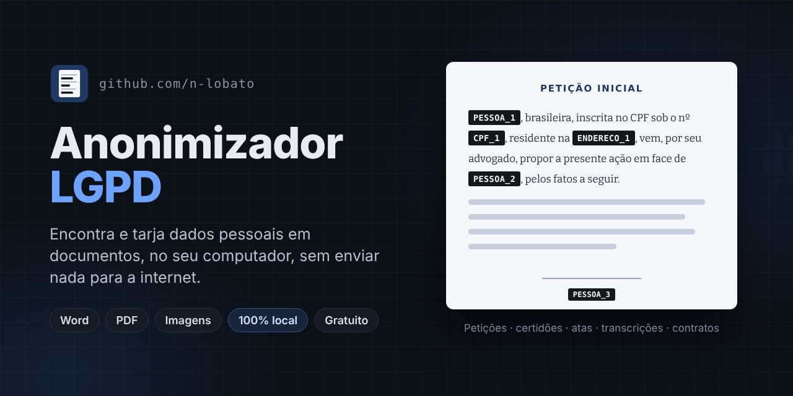

# Anonimizador LGPD



Programa para Windows, Mac e Linux que encontra e substitui dados pessoais em documentos: petições, decisões, certidões, atas, transcrições, contratos e similares. Tudo roda no seu computador. Nenhum arquivo é enviado para a internet.

Você arrasta arquivos ou pastas para a janela, confere o que foi encontrado e o programa grava uma cópia anonimizada no mesmo formato do original.

> **Qual programa usar?** Precisa do **próprio documento anonimizado**, em Word ou PDF com a mesma aparência do original (por exemplo, uma petição tarjada para enviar a alguém)? Use este, o Anonimizador LGPD. Precisa só do **texto** do documento para usar com IA, guardar ou pesquisar? Use o [Conversor Markdown](https://github.com/n-lobato/conversor-markdown), que converte para texto e também anonimiza. Os dois usam o mesmo motor de detecção de dados pessoais.

```
MARIA APARECIDA DE SOUZA, brasileira, CPF 529.982.247-25, residente na SQS 308, Bloco C...
```

vira

```
[PESSOA_1], brasileira, CPF [CPF_1], residente na [ENDERECO_1]...
```

A mesma pessoa recebe sempre o mesmo código, inclusive quando aparece de outra forma ("Maria Souza", "MARIA:", "a Sra. Souza"). Assim o documento continua legível.

> **Atenção: trocar nomes e números não garante, sozinho, que ninguém consiga descobrir de quem é o documento.** O cargo, o local, as datas e os fatos narrados podem bastar para identificar a pessoa. Pela LGPD (art. 12), o dado só deixa de ser pessoal quando a identificação não é possível por meios técnicos razoáveis. Leia o documento anonimizado inteiro antes de compartilhar e retire à mão o contexto que ainda identifique alguém.

## Download e instalação

Todos os arquivos ficam na página de [Releases](https://github.com/n-lobato/anonimizador-lgpd/releases/latest). O OCR em português já vem incluído em todos.

### Windows 10 e 11 (64 bits)

- **[Instalador](https://github.com/n-lobato/anonimizador-lgpd/releases/latest/download/AnonimizadorLGPD-windows-instalador.exe) (recomendado).** Instala só para o seu usuário, sem pedir senha de administrador, cria o atalho no menu Iniciar (e, se quiser, na Área de Trabalho) e aparece em **Configurações > Aplicativos > Aplicativos instalados**, de onde se desinstala. Para atualizar, basta rodar o instalador da versão nova. Ao desinstalar, as configurações do programa também são apagadas, inclusive as listas de termos próprios.
- **[Versão portátil (.zip)](https://github.com/n-lobato/anonimizador-lgpd/releases/latest/download/AnonimizadorLGPD-windows.zip).** Descompacte em qualquer pasta (ou pen drive) e execute `AnonimizadorLGPD.exe`. Não instala nada. Para remover, apague a pasta.

O Windows pode mostrar o aviso "O Windows protegeu o computador", porque o programa não tem assinatura digital paga. Clique em **Mais informações** e depois em **Executar assim mesmo**.

Abra o programa pelo menu Iniciar ou pelo atalho, e não "como administrador". Aberto como administrador, o Windows bloqueia arrastar arquivos do Explorer para a janela (o programa avisa quando isso acontece).

### Mac com chip Apple (M1, M2, M3, M4...), macOS 12 Monterey ou mais novo

- **[Anonimizador LGPD para Mac (.dmg)](https://github.com/n-lobato/anonimizador-lgpd/releases/latest/download/AnonimizadorLGPD-mac-apple-silicon.dmg)**

Não há versão para Macs com processador Intel. Para saber qual é o seu, abra o menu Apple > **Sobre Este Mac**: se aparecer a linha "Chip" com Apple M1, M2 etc., este pacote serve; se aparecer "Processador" com Intel, não serve.

Abra o .dmg e arraste **Anonimizador LGPD** para a pasta **Aplicativos**. Como o programa não tem certificado pago da Apple, o Mac bloqueia a primeira abertura. Para liberar, uma única vez:

1. Tente abrir o programa e clique em **OK** (ou **Concluído**) no aviso.
2. Abra **Ajustes do Sistema > Privacidade e Segurança**.
3. Role até o fim e clique em **Abrir Mesmo Assim** ao lado de "Anonimizador LGPD". Confirme com a senha ou o Touch ID.

Para desinstalar, arraste o programa da pasta Aplicativos para o Lixo.

### Linux (64 bits)

- **[Debian 12 ou mais novo, Ubuntu, Mint e derivados (.deb)](https://github.com/n-lobato/anonimizador-lgpd/releases/latest/download/AnonimizadorLGPD-linux-amd64.deb) (recomendado).** No terminal, na pasta do download: `sudo apt install ./AnonimizadorLGPD-linux-amd64.deb`. O programa aparece no menu de aplicativos. Para remover: `sudo apt remove anonimizador-lgpd`.
- **[Outras distribuições (.tar.gz)](https://github.com/n-lobato/anonimizador-lgpd/releases/latest/download/AnonimizadorLGPD-linux-x64.tar.gz).** Extraia, entre na pasta e rode `./instalar.sh`. Instala só para o seu usuário, sem sudo. Para remover, rode `./desinstalar.sh`.

### Conferir se o arquivo é o original

Os pacotes são gerados pelo GitHub Actions a partir do código deste repositório, e não no computador do autor. Cada arquivo vem acompanhado de um `.sha256` com a impressão digital (hash SHA-256) dele, que também aparece nas notas da versão. Para conferir, rode na pasta do download (troque pelo nome do arquivo baixado):

```
Get-FileHash .\AnonimizadorLGPD-windows.zip -Algorithm SHA256        # Windows (PowerShell)
shasum -a 256 AnonimizadorLGPD-mac-apple-silicon.dmg                 # Mac (Terminal)
sha256sum AnonimizadorLGPD-linux-amd64.deb                           # Linux
```

O código mostrado deve ser igual ao do arquivo `.sha256` e ao das notas da versão. Se for diferente, não use o arquivo.

O hash só prova que o arquivo chegou inteiro: como fica na mesma página do download, quem conseguisse trocar um pacote poderia trocar o hash junto. Por isso, a partir da versão 1.3.1, cada pacote também tem um **atestado de origem** assinado pelo GitHub, que prova que ele foi gerado pelo workflow deste repositório, a partir de um commit específico. O atestado fica registrado fora da página de Releases e não pode ser forjado por quem não controla o repositório. Para conferir, com o [GitHub CLI](https://cli.github.com) instalado:

```
gh attestation verify AnonimizadorLGPD-windows-instalador.exe -R n-lobato/anonimizador-lgpd
```

A resposta deve indicar que a verificação foi bem-sucedida e mostrar o workflow `.github/workflows/build.yml` deste repositório. O programa ainda não tem assinatura digital paga da Microsoft nem da Apple, por isso os avisos do Windows e do Mac na primeira abertura continuam.

Cada pacote traz também o arquivo `THIRD-PARTY-NOTICES.md` e a pasta `LICENCAS`, com os componentes de terceiros incluídos e as licenças de cada um.

## Como usar

Há três jeitos de colocar arquivos na fila:

1. Arrastar arquivos ou pastas para a janela do programa.
2. Arrastar arquivos sobre o ícone do programa: no Windows, o `AnonimizadorLGPD.exe` ou um atalho dele; no Mac, o ícone no Dock; no Linux, o atalho, se o seu ambiente permitir.
3. Só no Windows: clicar com o botão direito em arquivos ou pastas e usar **Enviar para > Anonimizador LGPD**. Para criar essa opção, use o menu **Ferramentas > Adicionar ao menu "Enviar para"**.

Os botões **Adicionar arquivos** e **Adicionar pasta** funcionam em todos os casos.

Depois clique em **Anonimizar**. Com a revisão ligada (recomendado), abre uma tela com tudo o que foi detectado:

- desmarque o que **não** deve ser substituído;
- selecione uma linha para ver o trecho em que o dado aparece;
- use **Unir selecionados** quando duas linhas forem a mesma pessoa;
- use **Adicionar termo** para incluir algo que o programa não reconheceu;
- **Nunca anonimizar** e **Sempre anonimizar** guardam a escolha na sua lista para as próximas vezes.

Os arquivos são gravados na subpasta `anonimizados`, ao lado dos originais, com o sufixo `_anonimizado`. Os originais nunca são alterados. Também é possível escolher outra pasta de saída; nesse caso a estrutura de subpastas é mantida.

## Formatos

| Formato | O que é feito |
|---|---|
| Word (.docx, .docm) | Substitui o texto mantendo a formatação. Alcança corpo, tabelas, caixas de texto, cabeçalhos, rodapés, notas, comentários, alterações controladas e os textos de gráficos e SmartArt. Limpa autor, empresa e autores de comentários e revisões. **Remove da cópia** os objetos incorporados (planilhas, PDFs e outros arquivos colados no documento), junto com as miniaturas deles, deixando no texto "[objeto incorporado removido]". Remove as macros: um .docm vira .docx. |
| PDF com texto | Tarja definitiva: o texto sob a tarja é **apagado do arquivo**, não apenas coberto. O código é escrito sobre a tarja. Remove metadados, anexos, links e valores de formulários. |
| PDF digitalizado | OCR em português e tarja nos pixels da imagem. |
| Imagens (.png, .jpg, .tif, .bmp) | OCR e tarja; a saída é uma imagem do mesmo tipo, sem os metadados EXIF. |
| Imagens coladas no Word e no Excel | As imagens em PNG, JPG, TIFF e BMP passam pelo mesmo OCR das imagens soltas. As que têm dado pessoal recebem tarja nos pixels; as demais perdem só os metadados (EXIF, que pode ter a localização GPS da foto, XMP e comentários). Com a opção **Remover as imagens do Word e do Excel**, cada imagem sai da cópia e, no Word, fica no lugar "[imagem removida]". |
| Texto (.txt, .md, .csv, .srt, .vtt) | Substituição direta, mantendo a codificação do arquivo. |
| Excel (.xlsx, .xlsm) | Substitui o texto das células, dos comentários, dos links, dos cabeçalhos e rodapés e os textos entre aspas dentro de fórmulas (referências e funções ficam intactas), e limpa o autor. **Remove da cópia** o que guarda dados fora das células: vínculos com outras planilhas (as fórmulas que dependiam deles viram o valor salvo, também anonimizado), o cache das tabelas dinâmicas (a tabela vira valores fixos), objetos incorporados e macros (um .xlsm vira .xlsx). |

**Verificação final.** Depois de gravar cada cópia, o programa procura nela os dados originais que foram substituídos (o nome, o CPF etc. exatamente como estavam). No Word e no Excel a busca passa por todas as partes do arquivo, inclusive as que o programa não trata; no PDF, pela camada de texto e pelos metadados. Se algo sobrou, aparece um aviso de **ATENÇÃO** com o tipo do dado e a parte do arquivo, sem mostrar o dado. O texto dentro de imagens não é conferido de novo.

**Metadados das imagens.** As imagens coladas no Word e no Excel que não recebem tarja são recriadas só a partir dos pixels: saem EXIF (inclusive GPS), XMP, comentários e as tags de autor e descrição do TIFF. Formatos testados: JPEG, PNG e TIFF (o BMP não guarda metadados).

**Arquivos danificados ou montados para travar o programa.** Documentos de terceiros podem chegar corrompidos ou ter sido preparados de propósito para esgotar a memória do computador (um .docx de poucos KB que vira gigabytes ao ser aberto, uma imagem que declara dimensões gigantescas, um XML com expansões em cascata). Desde a versão 1.4.3 o programa confere o tamanho e as dimensões antes de abrir e recusa o que for anormal, com uma mensagem clara, e segue com os outros arquivos do lote. Os limites ficam muito acima de documentos reais: 1 GB descompactado por arquivo do Office, 150 milhões de pixels por imagem (uma folha A4 a 600 dpi tem 35 milhões), 10.000 páginas por PDF e 300 MB por arquivo de texto. Ao varrer uma pasta, atalhos que apontam para outros lugares (links simbólicos e junções do Windows) não são seguidos: o programa avisa quantos encontrou, e você pode adicionar esses arquivos diretamente.

Formatos antigos (.doc, .xls, .rtf, .odt) devem ser salvos antes como .docx ou .xlsx. Apresentações ainda não são suportadas (exporte para PDF).

## O que é detectado

Nomes de pessoas (inclusive apelidos introduzidos por "vulgo" ou "conhecido como"), CPF, RG e identidade militar (inclusive o número do FUSEX), CNH, título de eleitor, PIS/PASEP/NIT, CTPS, passaporte, inscrição na OAB, matrícula (funcional, SIAPE, imóvel), registro em conselho profissional (CRM, CREA, CRESS e outros), CNPJ (inclusive o novo formato alfanumérico), número de processo no padrão CNJ, e-mail, telefone, endereço, CEP, data de nascimento, naturalidade (só quando vem com o rótulo, como em "natural de Belém/PA" ou "Naturalidade: Belém/PA"), registro civil citado em documentos (número, livro e folha do assento), placa de veículo, agência e conta bancária, cartão de crédito e endereço IP.

Em **Ferramentas > Tipos de dados a procurar** dá para desligar o que não interessa. Número de processo e CNPJ de empresa, por exemplo, costumam ser dados públicos.

### Como os nomes são reconhecidos

Documentos com dígito verificador (CPF, CNPJ, PIS, cartão, processo) são validados matematicamente. Números sem formato próprio (RG, CNH, conta) só são aceitos quando vêm junto da palavra que os identifica.

Para nomes, o programa usa regras explicáveis, sem inteligência artificial na nuvem:

- sequências de palavras com inicial maiúscula (ou em caixa alta), ligadas por "da", "de", "dos" etc.;
- listas de prenomes e sobrenomes brasileiros comuns;
- contexto jurídico: "requerente", "testemunha", "Sr.", "Dra.", ", brasileiro", ", CPF", rótulos de fala em transcrições ("MARIA:");
- profissões e relações antes do nome ("o engenheiro", "a vizinha", "a coordenadora"), linhas de assinatura (nome sozinho na linha, com o cargo logo abaixo), apelidos ("vulgo", "conhecido como") e colunas de tabela seguidas de CPF;
- exclusão de cargos, órgãos, meses, cidades, empresas ("Ltda", "S.A.") e homenagens ("Rua João Pessoa", "Lei Maria da Penha", "Câmara dos Deputados").

### Quanto ele acerta

A detecção foi medida em 18 documentos fictícios, com cada dado pessoal marcado à mão (pasta `tests/corpus`): petições, sentença, termos de audiência, atas, contrato, procuração, certidão de nascimento, e-mails, conversa de WhatsApp, boletim de ocorrência, laudo, ofício e lista de presença.

O número que vale é o da **validação**: 6 documentos escritos depois dos ajustes e que o programa nunca tinha "visto". Nesses textos, **sem a revisão manual**:

| | Versão 1.0.0 | Versão atual |
|---|---|---|
| Todos os dados pessoais (104) | 91% | 93% |
| Só nomes de pessoas (61) | 90% | 90% |
| Falsos positivos | 0 | 0 |

Ou seja: **cerca de 1 em cada 10 nomes passou sem ser detectado**. Os casos que escaparam foram apelidos ("conhecido na região como Magrão"), prenomes soltos em conversas ("o Josias"), um nome raro numa tabela e uma data de nascimento com o rótulo "Nascimento:". Esses casos foram corrigidos depois da medição, mas o número de referência continua sendo o medido antes, porque é o que indica o comportamento em documentos novos.

Cuidados ao interpretar:

- os documentos foram escritos por quem desenvolveu as regras, e os seus documentos reais serão mais variados. Espere um resultado **pior** do que o da tabela;
- a medição usa texto digital. Em PDF digitalizado e imagem, o resultado também depende da qualidade do OCR;
- um dado "coberto" é aquele em que todas as letras e números foram substituídos. Se sobrou parte do dado (por exemplo, um sobrenome), conta como vazamento.

#### Em PDF digitalizado

A mesma medição foi repetida com cada documento transformado num PDF que é só imagem, como um escaneado (200 dpi, sem sujeira nem inclinação). O programa anonimiza com OCR, e o resultado é lido de novo com OCR para ver o que continuou legível.

| | Desenvolvimento (188 dados) | Validação (103 dados) |
|---|---|---|
| Primeira medição | 97% | 80% |
| Depois das correções | 99% | 92% |

A primeira medição revelou dois problemas, depois corrigidos: nomes, endereços e números que quebravam no fim da linha não eram reconhecidos (isso valia para qualquer PDF, não só para os escaneados), e o OCR lê o "@" dos e-mails como "Q", "GQ" ou "(O", e nenhum e-mail era reconhecido. As correções usaram esses mesmos documentos, então o número que indica o comportamento em documentos novos é o da primeira medição. O ponto mais fraco que restou são **e-mails dentro de tabelas** em documentos escaneados.

Num escaneado real, com manchas, carimbos, assinaturas por cima do texto ou papel torto, o resultado tende a ser pior.

Para rodar a medição: `python build/avaliar.py --detalhes` (texto) e `python build/avaliar_ocr.py --detalhes` (PDF digitalizado, precisa do PyMuPDF e dos dados do OCR). Para contribuir com novos casos, veja `tests/corpus/LEIA-ME.md`.

Se o [spaCy](https://spacy.io) com um modelo em português estiver instalado (versão em código-fonte), ele é usado como reforço.

## Limitações (leia antes de usar)

- **Nenhuma detecção automática de nomes é perfeita.** Na medição acima, cerca de 1 em cada 10 nomes passou. Nomes raros, apelidos, prenomes soltos e nomes escritos em minúsculas são os que mais escapam, e algumas palavras podem ser marcadas por engano. Por isso a revisão vem ligada por padrão. Confira o resultado antes de compartilhar.
- Nomes de rua sem número ("Avenida Pau-Brasil") são tratados como endereço, mesmo quando são só referência de lugar. Desmarque na revisão quando não for o caso.
- Nas imagens coladas no Word e no Excel, o OCR lê bem prints e documentos digitalizados, mas erra em fotos tortas, borradas, com reflexo ou letra pequena. E **não enxerga o que não é texto**: rosto, assinatura, carimbo, impressão digital. Imagens em formato vetorial do Office (EMF, WMF, SVG) e GIF não passam pelo OCR. Quando houver dúvida, use a opção de remover as imagens.
- No Windows, o motor do OCR não abre os dados de idioma num caminho com acento (por exemplo, o programa portátil dentro de "Área de Trabalho" ou um usuário "João"). Desde a versão 1.4.0 o programa contorna isso sozinho, usando o nome curto da pasta ou uma cópia dos dados em `C:\ProgramData\AnonimizadorLGPD`. Nas versões anteriores, o OCR nesses casos não lia nada e o programa não avisava. Se o OCR mesmo assim não conseguir ler, o programa avisa em vez de dizer que não encontrou dados.
- No PDF, quando o nome é curto e o código não cabe na tarja, ela fica só preta. A correspondência continua no relatório.
- O OCR depende da qualidade da digitalização. Documentos tortos, manuscritos ou de baixa resolução podem ter falhas. Em escaneados, confira com atenção e-mails e dados dentro de tabelas: o OCR costuma ler o "@" errado.
- Cópias de planilhas podem perder gráficos e imagens (limitação da biblioteca openpyxl).
- Anonimizar com código numerado é, tecnicamente, **pseudonimização**: quem tiver o relatório consegue reverter. Para fins da LGPD (art. 12 e art. 13, § 4º), guarde o relatório separado e protegido, ou não o gere.

## Relatório de-para

Se você marcar a opção (ela vem desmarcada), o programa gera uma planilha `relatorio_anonimizacao_AAAAMMDD_HHMMSS.xlsx` com cada código e o dado original, as ocorrências e os avisos de cada arquivo. **Esse arquivo contém os dados pessoais originais e permite desfazer a anonimização.**

Para que ele não seja enviado por engano, a planilha nunca fica na pasta dos documentos anonimizados. Ela vai para a pasta `Relatório de-para (NÃO COMPARTILHAR)`, ao lado dos originais. Se essa pasta ficar dentro da pasta de saída escolhida, o relatório vai para a pasta de configurações do programa (subpasta `relatorios`). O caminho aparece no registro da janela ao final. Os textos da planilha são gravados sempre como texto, nunca como fórmula.

Até a versão 1.3.0 a opção vinha marcada e o relatório ficava dentro da pasta `anonimizados`. Se você usou essas versões, confira se não enviou algum relatório junto com os documentos. Na primeira abertura da 1.3.1 a opção é desmarcada uma vez; depois disso, a sua escolha é respeitada.

## Linha de comando

O pacote inclui a linha de comando, útil para lotes grandes ou automação (sem revisão manual). No Windows é o `anonimizador-cli.exe`, na mesma pasta do programa; no Linux, o comando `anonimizador-cli`; no Mac, fica em `/Applications/Anonimizador LGPD.app/Contents/MacOS/anonimizador-cli`.

```
anonimizador-cli.exe "C:\Processos\2026" -o "D:\Anonimizados"
anonimizador-cli.exe peticao.docx --apenas-analisar
anonimizador-cli.exe pasta --tipos PESSOA,CPF,RG,ENDERECO
anonimizador-cli.exe pasta --relatorio        # gera também o de-para (fora da pasta de saída)
anonimizador-cli.exe pasta --remover-imagens  # tira as imagens do Word e do Excel em vez de passar OCR
anonimizador-cli.exe --help
```

A linha de comando não tem a tela de revisão: serve para lotes e automação, não como prova de que os documentos estão anonimizados. O código de saída ajuda a automatizar a conferência: **0** quando tudo correu bem, **1** quando não havia nenhum arquivo suportado, **2** quando algum arquivo deu erro e **3** quando as cópias foram geradas, mas algum arquivo tem aviso de ATENÇÃO (OCR que não leu, imagem que não pôde ser analisada ou dado original encontrado na verificação final). Esses devem ser revistos antes de qualquer envio.

## Configurações e lista de termos

Ficam em `config.json` e `termos.json`, na pasta `%APPDATA%\AnonimizadorLGPD` no Windows, `~/Library/Application Support/Anonimizador LGPD` no Mac e `~/.config/anonimizador-lgpd` no Linux. O menu **Ferramentas > Abrir pasta de configurações** abre a pasta certa. A lista de termos pode ser editada em **Ferramentas > Minha lista de termos**:

- **Sempre anonimizar**: nomes ou expressões que devem ser substituídos sempre (com o tipo desejado).
- **Nunca anonimizar**: expressões que não devem ser tocadas (nome do órgão, de uma lei, de um logradouro).

## Rodar a partir do código-fonte

Requer Python 3.10 ou superior.

```
git clone https://github.com/n-lobato/anonimizador-lgpd.git
cd anonimizador-lgpd
pip install -r requirements-dev.txt
python build/baixar_tessdata.py      # dados do OCR em português
python iniciar.py                     # abre a janela
python iniciar.py --cli arquivo.pdf   # linha de comando
python -m pytest                      # testes
python build/avaliar.py --detalhes    # mede os acertos no corpus de teste
pyinstaller anonimizador.spec         # gera o executável em dist/ (no Mac, o .app)
```

A cada envio para o GitHub, o GitHub Actions faz o seguinte nos três sistemas:

- roda os testes e mede os acertos no corpus de teste (texto e PDF digitalizado);
- gera os pacotes: no Windows, o .zip e o instalador ([Inno Setup 6](https://jrsoftware.org/isinfo.php), `build/instalador.iss`); no Mac, o .dmg para chip Apple (`build/build_mac.sh`); no Linux, o .deb e o .tar.gz (`build/build_linux.sh`, gerados no Ubuntu 22.04 para rodar também em sistemas mais antigos);
- testa cada pacote pronto com `build/testar_pacote.py`: anonimiza um texto, um PDF e um PDF digitalizado e abre a janela. O .deb também é instalado e testado num Debian 12 e num Debian 13 limpos;
- compara a medição de acertos do Mac e do Linux com a do Windows (`build/comparar_medicoes.py`). Se algum sistema anonimizar pior, o build falha.

Uma diferença de versão entre os sistemas: no Mac, a interface usa o PySide6 6.9.3, porque o 6.12 exige o macOS 26. Não há versão para Mac Intel porque o PyMuPDF 2.1, usado na leitura e na tarja dos PDFs, não tem pacote para esse processador.

Para publicar uma versão, rode o workflow manualmente com a opção "Publicar" marcada (ou crie uma tag `v*`). Todos os pacotes vão juntos para Releases, com o SHA-256 de cada um.

## Estrutura

```
src/anonimizador/
  deteccao/     padrões, validadores e reconhecimento de nomes
  formatos/     leitura e gravação de docx, pdf, imagens, texto e xlsx;
                limites.py recusa arquivos montados para travar o programa
  gui/          janela, tela de revisão e diálogos (PySide6)
  registro.py   códigos e variantes de cada pessoa ou dado
  processador.py  fluxo listar > analisar > revisar > gravar
  relatorio.py  tabela de-para em Excel
  cli.py        linha de comando
tests/          testes automatizados
```

## Licença

GPL-3.0. O programa usa o [PyMuPDF](https://pymupdf.readthedocs.io), distribuído sob AGPL-3.0, para a tarja de PDFs; por isso o código deste projeto também é livre. Os dados de idioma do OCR vêm do projeto [tessdata_fast](https://github.com/tesseract-ocr/tessdata_fast) (Apache-2.0).

Autor: **n-lobato**

### Sobre o uso de inteligência artificial

O desenvolvimento contou com o Claude, assistente de IA da Anthropic, na escrita do código, dos testes e desta documentação. As escolhas sobre como o programa funciona foram feitas pelo autor. O código é aberto justamente para que qualquer pessoa possa conferir o que ele faz, e a medição de acertos acima existe para que ninguém precise confiar só na palavra de quem o fez.

Este programa é uma ferramenta de apoio. A responsabilidade pela conferência do resultado e pelo tratamento adequado dos dados é de quem o utiliza.
